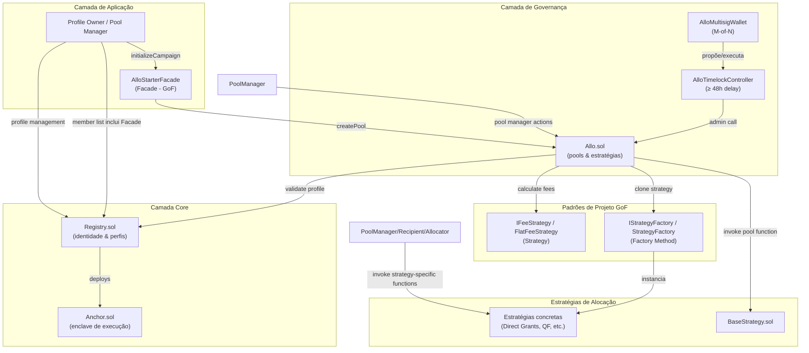

## Visão geral

O Allo Protocol é um ecossistema sofisticado na blockchain Ethereum que permite a alocação e distribuição automatizada e descentralizada de fundos. O protocolo é composto por um conjunto de smart contracts que, em conjunto, oferecem um framework avançado para gestão de fundos, manipulação de taxas e governança.

Esta versão (`ALLO-v2`) mantém a arquitetura original da Gitcoin e adiciona uma camada de abstração baseada em padrões de projeto GoF, além de uma estrutura de governança on-chain com multisig e timelock.

## Diagrama de arquitetura atual



## Visão geral dos contratos

| Contrato | Propósito |
|---|---|
| `Registry.sol` | Registro de perfis que oferece gestão de identidade e permissões |
| `Anchor.sol` | Enclave que pode receber fundos / executar transações; gerado a partir do `identityId` e nome do perfil |
| `Allo.sol` | Gerenciamento de pools; requer perfil do Registry e estratégia que implementa `BaseStrategy.sol` |
| `BaseStrategy.sol` | Contrato abstrato que implementa `IStrategy.sol`; toda estratégia válida deve sobrescrever suas funções internas |
| `AlloStarterFacade.sol` | **Novo** — Facade (GoF) que simplifica a criação de campanhas sem quebrar o modelo de permissões |
| `IFeeStrategy.sol` / `FlatFeeStrategy.sol` | **Novo** — Strategy (GoF) para cálculo desacoplado de taxas |
| `IStrategyFactory.sol` / `StrategyFactory.sol` | **Novo** — Factory Method (GoF) para instanciação de estratégias |
| `AlloTimelockController.sol` | **Novo** — Timelock com delay mínimo de 48 horas para ações administrativas |
| `AlloMultisigWallet.sol` | **Novo** — Multisig M-of-N que propõe e executa operações no timelock |

## Contratos core

### Registry Contract (`Registry.sol`)

O contrato `Registry` é o bloco de construção fundacional do Allo Protocol. Ele facilita a criação, atestação e gestão de perfis. Um perfil é uma entidade única que representa a identidade de um usuário dentro do protocolo. Este contrato oferece funções para consultar perfis por ID e anchor, bem como criar novos perfis com metadados personalizados, endereços de atestação e membros.

Cada vez que um perfil gera um novo anchor (durante a criação do perfil ou quando o nome é atualizado), ocorre o deploy de um contrato `Anchor`. Esses contratos servem como ferramentas versáteis que podem receber fundos ou cumprir outros propósitos designados. Este mecanismo dinâmico permite que os perfis se envolvam em uma ampla gama de atividades dentro do protocolo, aumentando a flexibilidade e a funcionalidade em todo o ecossistema Allo.

### Anchor Contract (`Anchor.sol`)

O contrato `Anchor` é um componente vital que amplia as capacidades dos perfis. Ele atua como um enclave isolado, permitindo que os proprietários de perfis interajam com segurança com endereços externos. Os proprietários podem executar chamadas para endereços-alvo mantendo controle sobre a quantidade de tokens nativos enviados e os dados transmitidos. Este contrato utiliza o `Registry` para verificar a propriedade, garantindo que apenas usuários autorizados possam utilizar sua funcionalidade.

### Allo Contract (`Allo.sol`)

No coração do Allo Protocol está o contrato `Allo`, um smart contract versátil e rico em recursos que permite a alocação e distribuição eficiente e descentralizada de fundos. O contrato abrange mecanismos para manipulação de taxas, gestão de tesouraria e definição de controles de acesso. Seu design abrangente é composto por funções, variáveis, modificadores e eventos distintos que colaboram para oferecer um framework robusto de gestão de fundos.

Nesta versão refatorada, o `Allo` também integra:

- `IFeeStrategy` para cálculo desacoplado de taxas.
- `IStrategyFactory` para criação desacoplada de estratégias.
- `initializeGoFPatterns()` para migração atômica segura em upgrades.

## Funcionalidades e interações principais

### Criação e gestão de perfis

O protocolo Allo começa com a criação e gestão de perfis através do contrato `Registry`. Os usuários podem criar perfis, cada um identificado por um profile ID único. Metadados, endereços de atestação e membros podem ser personalizados durante a criação. O contrato `Registry` garante que apenas usuários autorizados possam manipular perfis verificando a propriedade.

### Interações externas seguras

O contrato `Anchor` faz a ponte entre os proprietários de perfis e endereços externos. Ele fornece um gateway seguro para que os proprietários executem chamadas para contratos externos, especificando a quantidade de tokens nativos e os dados a serem enviados. O `Anchor` incorpora o `Registry` para validar a propriedade do perfil, garantindo que apenas proprietários legítimos possam acessar suas funcionalidades.

### Alocação e distribuição avançada de fundos

A essência da funcionalidade do protocolo reside no contrato `Allo`, que permite a gestão descentralizada e automatizada de fundos. As pools são criadas e gerenciadas neste contrato, cada uma com estratégias personalizáveis para alocação e distribuição. Os usuários podem criar pools, definir parâmetros e definir estratégias, enquanto administradores e gerentes controlam a alocação e distribuição efetiva dos fundos.

### Manipulação de taxas e gestão da tesouraria

O contrato `Allo` incorpora um sistema abrangente de gestão de taxas. O proprietário do contrato pode definir e atualizar parâmetros de taxas, controlar endereços de tesouraria e recuperar fundos. Esta estrutura de taxas garante a sustentabilidade e adaptabilidade do protocolo. O mecanismo de gestão da tesouraria aumenta a robustez do contrato ao permitir a recuperação controlada de fundos.

## Papéis e atores

O Allo Protocol delega papéis distintos aos participantes para fomentar uma governança eficiente:

- **Profile Owners:** Usuários que criam perfis usando o contrato `Registry`. Esses perfis são centrais para as interações do protocolo, oferecendo uma identidade única e permitindo chamadas externas seguras através do `Anchor`.
- **Allo Owner:** Indivíduos que controlam o contrato `Allo`, com autoridade para gerenciar recuperação de fundos, parâmetros de taxas e endereços de tesouraria. Seu papel é fundamental para a estabilidade financeira do protocolo.
- **Profile Member:** Membros de um perfil do Registry possuem direitos de acesso específicos conforme definido pelo proprietário do perfil.
- **Pool Creator:** Usuário que pode criar novas pools usando estratégias customizadas ou clonáveis, especificando metadados, endereços de estratégia, gerentes e outros parâmetros.
- **Pool Administrator:** Usuários com controle administrativo sobre pools específicas. Podem gerenciar os pool managers.
- **Pool Manager:** Usuários que gerenciam fundos dentro de pools específicas, alocando e distribuindo fundos de acordo com a estratégia da pool.
- **Governance Signers:** Signatários da `AlloMultisigWallet` que propõem, confirmam e executam ações administrativas através do timelock.

## Padrões de projeto aplicados

### Facade — `AlloStarterFacade.sol`

A fachada oferece um ponto de entrada simplificado para criar uma campanha. O fluxo corrigido preserva a identidade do usuário:

1. O usuário cria um perfil no `Registry` e adiciona a fachada como membro.
2. O usuário chama `initializeCampaign(...)` na fachada.
3. A fachada cria a pool no `Allo`, concede ao usuário a role de manager e retorna o `poolId`.

> **Segurança:** o usuário continua sendo o owner do perfil e pool manager. A fachada detém apenas a role de admin do pool e só pode exercê-la mediante verificação de ownership.

### Strategy — `IFeeStrategy.sol` / `FlatFeeStrategy.sol`

O cálculo de taxas foi extraído do `Allo.sol` para uma família de estratégias:

```solidity
interface IFeeStrategy {
    function getFee(uint256 _amount) external view returns (uint256);
    function getBaseFee() external view returns (uint256);
}
```

A implementação `FlatFeeStrategy` retorna percentuais e taxas base configuráveis. Isso permite substituir o algoritmo de fee sem recompilar o `Allo`.

### Factory Method — `StrategyFactory.sol`

A criação de novas instâncias de estratégias é delegada a uma fábrica:

```solidity
interface IStrategyFactory {
    function createStrategy(
        address _implementation,
        bytes memory _initStrategyData
    ) external returns (address);
}
```

A fábrica gerencia nonces e clonagem, isolando o `Allo` dessa complexidade.

### State — `BaseStrategy.sol` / estratégias derivadas

As estratégias modelam o ciclo de vida das pools através de estados explícitos:

| Estado | Significado |
|---|---|
| `None` | Estado inicial |
| `Active` | Pool aceitando registros |
| `Rejected` | Pool rejeitada |
| `Appeal` | Período de recurso |
| `Paid` | Distribuição concluída |

Cada transição de estado dispara ações específicas (registro, alocação, distribuição), tornando o comportamento previsível e auditável.

## Fluxos de usuário

### Allo Contract

- **Funcionalidade:** gerencia a criação e operação de pools, estratégias e alocação de fundos no ecossistema Allo.
- **Interações:**
  - Interage com o `Registry` para gerenciar perfis de usuários e verificar autorização.
  - Interage com estratégias individuais (herdeiras de `BaseStrategy`) para alocação e distribuição.
  - Interage com o `Anchor` para executar chamadas arbitrárias a endereços-alvo.
- **Fluxos:**
  - Usuários criam pools usando estratégias customizadas ou clonáveis.
  - As pools são financiadas e os fundos alocados são distribuídos entre recipients conforme a lógica da estratégia.
  - Operações em lote podem registrar e alocar fundos para múltiplos recipients simultaneamente.
  - O contrato gerencia ownership e papéis de managers e administradores.
  - O proprietário do contrato pode gerenciar parâmetros como percentuais de taxa, taxas base e estratégias aprovadas.
  - Usuários podem recuperar fundos do contrato.

### Registry Contract

- **Funcionalidade:** gerencia perfis de usuários e suas permissões associadas.
- **Interações:** valida se um usuário ou endereço tem as permissões necessárias para criar ou gerenciar pools.
- **Fluxos:**
  - Usuários criam perfis e associam endereços para estabelecer papéis e permissões.
  - Perfis definem permissões para criação e gestão de pools.
  - Um perfil pode ter múltiplos endereços associados, permitindo colaboração.
  - O `Allo` consulta o `Registry` para verificar permissões antes de executar ações.

### Anchor Contract

- **Funcionalidade:** permite a execução de chamadas arbitrárias para endereços-alvo baseadas em condições específicas.
- **Interações:** interage com o `Allo`, permitindo que usuários autorizados (como pool managers) iniciem chamadas para endereços externos.
- **Fluxos:**
  - Usuários autorizados podem iniciar chamadas para endereços-alvo usando a função `execute`.
  - As chamadas podem incluir o envio de tokens nativos junto com os dados.
  - Facilita a integração com sistemas e contratos externos, permitindo ações dinâmicas baseadas em condições pré-definidas.

### Interação geral

1. Usuários criam perfis no contrato `Registry` e associam seus endereços a papéis e permissões específicos.
2. Usuários, identificados por seus endereços e perfis associados, interagem com o contrato `Allo` para criar pools, alocar fundos e gerenciar pools.
3. O contrato `Allo` verifica os perfis dos usuários com o `Registry` para garantir que apenas usuários autorizados executem certas ações.
4. Estratégias (herdadas de `BaseStrategy`) dentro do `Allo` lidam com alocação, distribuição e gestão de fundos com base em lógica específica.
5. O contrato `Anchor` permite a execução dinâmica de chamadas arbitrárias com base em condições pré-definidas, frequentemente desencadeadas por eventos no ecossistema `Allo`.
6. Juntos, esses contratos criam um ecossistema onde os usuários podem gerenciar e alocar fundos de acordo com várias estratégias, respeitando permissões e condições pré-definidas.

## Camada de governança

A governança é composta por:

- `AlloTimelockController` — contrato de timelock com delay mínimo de 48 horas.
- `AlloMultisigWallet` — multisig M-of-N que propõe e executa operações no timelock.
- Scripts em `scripts/governance/` para deploy, proposta, confirmação e execução.

Operações administrativas (upgrades, mudança de parâmetros, recuperação de fundos) devem seguir o ciclo: **propor → confirmar N vezes → aguardar timelock → executar**.

## Conclusão

O Allo Protocol é um framework tecnologicamente avançado para alocação e distribuição descentralizada de fundos. Ao empregar os contratos `Registry`, `Anchor` e `Allo` em conjunto, o protocolo estabelece um ecossistema onde os usuários podem gerenciar fundos com segurança, definir estratégias e participar de um ecossistema DeFi que incorpora transparência e governança centrada no usuário.
