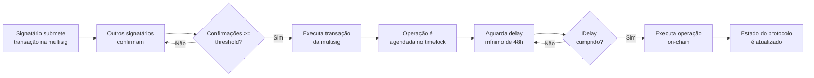

## Princípios da governança

A governança do ALLO-v2 segue o princípio de **mínimo privilégio** e **decisão coletiva com execução retardada**: nenhuma pessoa sozinha pode alterar o protocolo. Toda ação administrativa passa por uma **multisig M-of-N** e por um **timelock on-chain de pelo menos 48 horas**.

Esse modelo não é uma DAO completa com token de governança, mas uma **estrutura de governança administrativa** que pode ser integrada a uma DAO tokenizada no futuro, conforme previsto nos requisitos do projeto.

## Componentes

### AlloTimelockController

Contrato baseado no `TimelockController` da OpenZeppelin, com as seguintes características:

- **Delay mínimo:** 48 horas (`2 days`).
- **Proposer único:** a `AlloMultisigWallet`.
- **Executor único:** a `AlloMultisigWallet`.
- **Canceller:** a `AlloMultisigWallet`.
- Após o deploy, o deployer renuncia ao papel de admin do timelock.

```solidity
contract AlloTimelockController is TimelockController {
    uint256 public constant MINIMUM_DELAY = 2 days;
    // ...
}
```

### AlloMultisigWallet

Carteira multisig leve que gerencia propostas administrativas:

- Transações representadas por `Transaction { target, value, data, executed, cancelled, confirmations }`.
- Apenas signatários podem submeter, confirmar, revogar, cancelar e executar transações.
- Alterações no conjunto de signatários ou no threshold só podem ser feitas pela própria multisig, via transação bem-sucedida.

## Ciclo de vida de uma proposta



### 1. Submissão

Um signatário cria uma transação na multisig. Por exemplo, para agendar um upgrade do `Allo`:

```bash
GOV_SIGNER_PRIVATE_KEY=0x... \
  npx hardhat run scripts/governance/upgradeAlloViaGovernance.ts --network sepolia
```

O script:

1. Valida o storage layout com `upgrades.validateUpgrade`.
2. Implanta a nova implementação com `prepareUpgrade`.
3. Codifica `ProxyAdmin.upgradeAndCall(proxy, newImpl, initializeGoFPatterns())`.
4. Agenda a operação no timelock via multisig.
5. Retorna o `transactionId` da multisig.

### 2. Confirmação

Outros signatários confirmam a transação até atingir o threshold:

```bash
PROPOSAL_TX_ID=0 GOV_SIGNER_PRIVATE_KEY=0x... \
  npx hardhat run scripts/governance/confirmProposal.ts --network sepolia
```

Cada confirmação é uma transação separada na multisig. O script verifica o número atual de confirmações e o threshold configurado.

### 3. Execução da multisig

Após atingir o threshold, qualquer signatário pode executar a transação da multisig, que chama o timelock para agendar a operação:

```bash
PROPOSAL_TX_ID=0 GOV_SIGNER_PRIVATE_KEY=0x... \
  npx hardhat run scripts/governance/executeProposal.ts --network sepolia
```

### 4. Timelock

A operação fica bloqueada no timelock pelo período mínimo de 48 horas. Durante esse período, a comunidade pode inspecionar:

- O `operationId` da operação.
- O alvo (`target`).
- O calldata (`data`).
- O delay e o timestamp de liberação.

### 5. Execução on-chain

Após o delay, a mesma transação da multisig (ou outra equivalente) pode executar a operação do timelock. O script `executeProposal.ts` verifica se a operação subjacente está pronta (`isOperationReady`) antes de prosseguir.

## Propostas administrativas genéricas

Para operações que não sejam upgrades (ex.: alterar parâmetro de taxa, transferir ownership), use `proposeAdminCall.ts`:

```bash
PROPOSAL_TARGET=0x... \
PROPOSAL_DATA=0x... \
PROPOSAL_DELAY=172800 \
GOV_SIGNER_PRIVATE_KEY=0x... \
  npx hardhat run scripts/governance/proposeAdminCall.ts --network sepolia
```

## Papéis e separação de responsabilidades

| Papel | Responsabilidade |
|---|---|
| **Deployer** | Publicar implementação/proxy; remover privilégios após o deploy. |
| **Proxy Admin** | Executar upgrades; controlado pelo timelock. |
| **Allo Owner** | Parâmetros, plugins e recuperação de fundos; controlado pelo timelock. |
| **Registry Owner** | Recuperação autorizada do Registry. |
| **Relayer** | Operações rotineiras; sem privilégios administrativos. |
| **Treasury** | Receber taxas; multisig ou tesouraria auditada. |

## Segurança

- Chaves administrativas devem estar em hardware wallet, HSM ou cofre.
- Nunca passe chaves privadas como argumentos de linha de comando (use variáveis de ambiente).
- Sempre simule a operação em fork antes de executar em testnet/mainnet.
- Verifique o storage layout antes de qualquer upgrade.
- Após o deploy, o deployer deve renunciar a todos os papéis temporários.

## Futuro: DAO tokenizada

Os requisitos do projeto preveem que uma DAO completa, se adicionada, deve implementar:

- Estados de proposta (`Pending`, `Active`, `Canceled`, `Defeated`, `Succeeded`, `Queued`, `Executed`, `Expired`).
- Quorum configurável.
- Duração de votação e cooldown entre propostas.
- Delegação de votos.
- Lista de permissão de executores.
- Pausabilidade de emergência.
- Timelock.
