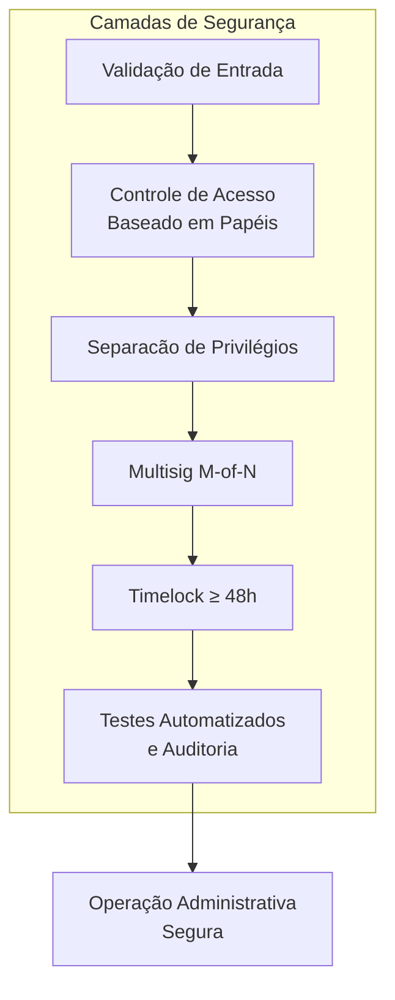

## Visão geral

A segurança do ALLO-v2 é estruturada em camadas: validação de entrada, controle de acesso baseado em papéis, separação de privilégios, multisig, timelock on-chain e testes automatizados. Cada uma dessas camadas trabalha para reduzir a superfície de ataque e limitar o impacto de uma possível compromise.



## Segredos e chaves

- `RELAYER_PRIVATE_KEY`, `SERVER_ENCRYPTION_PRIVATE_KEY`, `RESPONSE_SIGNING_KEY` e chaves de deploy ficam apenas em `.env` e nos secrets da Vercel/GitHub Actions.
- Nunca commite `.env`, `.env.local` ou arquivos `*.key`.
- Nunca exponha chaves em logs, respostas de API ou documentação.
- Ao ler segredos, use `process.env.VAR_NAME`; nunca hardcode valores.

## Papéis e separação de responsabilidades

| Papel | Função | Restrição |
|---|---|---|
| **Deployer** | Publica implementações e proxies | Remover privilégios após o deploy |
| **Proxy Admin** | Executa upgrades | Controlado pelo timelock |
| **Allo Owner** | Parâmetros e recuperação de fundos | Controlado pelo timelock |
| **Registry Owner** | Recuperação autorizada do Registry | Multisig separada |
| **Relayer** | Operações rotineiras | Sem privilégios administrativos |
| **Treasury** | Recebe taxas | Multisig ou tesouraria auditada |

## Upgrade seguro

O upgrade de uma instância anterior do `Allo` deve ser atômico, chamando `initializeGoFPatterns()` no mesmo momento do upgrade:

```solidity
ProxyAdmin.upgradeAndCall(
    proxy,
    newImplementation,
    abi.encodeWithSelector(Allo.initializeGoFPatterns.selector)
);
```

### Pré-requisitos de upgrade

- [ ] Código congelado e commit/tag auditado.
- [ ] `forge build --sizes` sem contratos core acima de 24 KB.
- [ ] Testes unitários, integração, upgrade e invariantes aprovados.
- [ ] Cobertura core >= 90%.
- [ ] Slither sem findings high/medium não justificados.
- [ ] Mythril sem finding crítico.
- [ ] Echidna sem falha de invariante.
- [ ] `validateUpgrade` e storage layout aprovados.
- [ ] Fork de mainnet e testnet aprovados.
- [ ] Owner, Proxy Admin e treasury são endereços não zero conferidos.
- [ ] Timelock on-chain >= 48h configurado.

## Timelock

Toda ação administrativa passa pelo `AlloTimelockController` com delay mínimo de 48 horas. Isso permite:

- Inspeção pública do calldata antes da execução.
- Tempo para signatários revogarem uma proposta maliciosa.
- Prevenção de ações unilaterais imediatas.

## Validação de entrada

- Endereços são validados e normalizados (`getAddress`).
- Nonces duplicados são rejeitados.
- Chain IDs são verificados nos scripts.
- Taxas nunca podem exceder o valor financiado.
- Estratégias e fábricas devem possuir bytecode válido.

## Resposta a incidentes

Em caso de incidente:

1. Interrompa operações off-chain e alerte signatários.
2. Preserve hashes de transação, blocos e logs sanitizados.
3. Avalie retirada segura e impacto sobre pools.
4. Proponha correção/rollback via multisig e timelock.
5. Rotacione chaves comprometidas e remova privilégios temporários.
6. Publique post-mortem sem segredos ou PII.

## Auditoria

O repositório mantém relatórios de auditoria e checklists em `docs/`:

- [`docs/audit-report.md`](/audit-report.md)
- [`docs/security-checklist.md`](/security-checklist.md)
- [`docs/deployment-security.md`](/deployment-security.md)
- [`docs/secure-tests/`](/secure-tests/)
