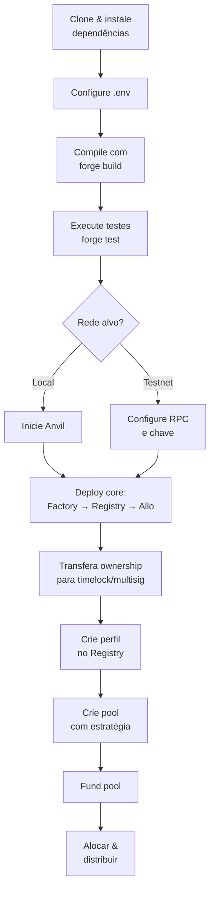

## Pré-requisitos

Antes de começar, certifique-se de ter instalado:

- [Node.js](https://nodejs.org/) 22.13.0 ou superior (recomendado para o Hardhat disponível no projeto).
- [Foundry](https://book.getfoundry.sh/getting-started/installation) para compilação e testes.
- [Bun](https://bun.sh/) (usado nos scripts do projeto) ou npm para instalar dependências.

## 1. Clone o repositório

```bash
git clone https://github.com/RapportTecnologia/allo.git
cd allo
```

> Se estiver trabalhando no fork acadêmico, use o repositório correspondente.

## 2. Instale as dependências

```bash
# Dependências Foundry
forge install

# Dependências JavaScript
bun install
```

Ou, se preferir npm:

```bash
npm install
```

## 3. Configure as variáveis de ambiente

Copie o arquivo de exemplo e preencha com suas chaves e URLs de RPC:

```bash
cp .env.sample .env
```

O arquivo `.env` deve conter, no mínimo:

```text
ALCHEMY_API_KEY=...
INFURA_API_KEY=...
ETHERSCAN_API_KEY=...
DEPLOYER_PRIVATE_KEY=...
```

> **Atenção:** nunca commit o arquivo `.env`. Ele já está listado no `.gitignore`.

## 4. Compile os contratos

```bash
bun run build
# ou
forge build
```

## 5. Execute os testes

```bash
bun run test
# ou
forge test --no-match-contract '(Lockup|SQF)'
```

A exclusão de `Lockup` e `SQF` evita testes que dependem de contratos experimentais ou de fork de mainnet.

## 6. Deploy dos contratos core



### Deploy local com Anvil

Inicie uma rede local:

```bash
anvil --block-time 10
```

Em outro terminal, execute os scripts de deploy:

```bash
npx hardhat run scripts/core/deployContractFactory.ts --network localhost
npx hardhat run scripts/core/deployRegistry.ts --network localhost
npx hardhat run scripts/core/deployAllo.ts --network localhost
```

### Deploy em testnet

Configure `hardhat.config.ts` com a URL da RPC e a chave privada do deployer. Em seguida:

```bash
npx hardhat run scripts/core/deployAllo.ts --network sepolia
```

Após o deploy, atualize o `ProxyAdmin` owner para o timelock/multisig usando `transferOwnershipToGovernance.ts`.

## 7. Criar um perfil

```bash
npx hardhat run scripts/test/createProfile.ts --network sepolia
```

O script criará um perfil no `Registry` e um `Anchor` associado.

## 8. Criar uma pool

Com o perfil criado e o endereço anotado:

```bash
npx hardhat run scripts/test/createPool.ts --network sepolia
```

Ou, para uma pool de alocação direta:

```bash
npx hardhat run scripts/test/createDirectAllocationPool.ts --network sepolia
```

## 9. Usar a AlloStarterFacade

A fachada reduz a complexidade para criar uma campanha. O fluxo correto é:

1. Crie um perfil no Registry com a fachada como membro:

   ```solidity
   registry.createProfile(
       _nonce,
       _name,
       _metadata,
       msg.sender,        // owner = você
       [facadeAddress]    // membros incluem a fachada
   );
   ```

2. Aprove o token ERC-20 na fachada (se for financiar com ERC-20).

3. Chame `initializeCampaign`:

   ```solidity
   facade.initializeCampaign(
       _profileId,
       _strategy,
       _initStrategyData,
       _token,
       _amount,
       _metadata,
       _managers
   );
   ```

Você continua sendo o owner do perfil e recebe a role de `POOL_MANAGER_ROLE`. A fachada fica com a role de admin do pool, mas só pode adicionar/remover managers quando você, como owner do perfil, autoriza.

## 10. Financiar uma pool

```bash
npx hardhat run scripts/test/fundPool.ts --network sepolia
```

Ou diretamente via `Allo.fundPool(poolId, amount)` com o token correto aprovado.

## Finalidades do projeto

O ALLO-v2 pode ser usado para:

- **Financiamento coletivo** com alocação baseada em estratégias customizadas.
- **Quadratic funding** e outras formas de matching de doações.
- **Direct grants** com ciclos de aprovação e pagamento.
- **Gestão de tesourarias** descentralizadas com controle por multisig/timelock.
- **Experimentação acadêmica** sobre padrões de projeto em Solidity.
